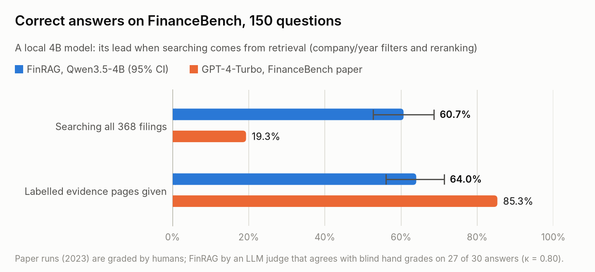
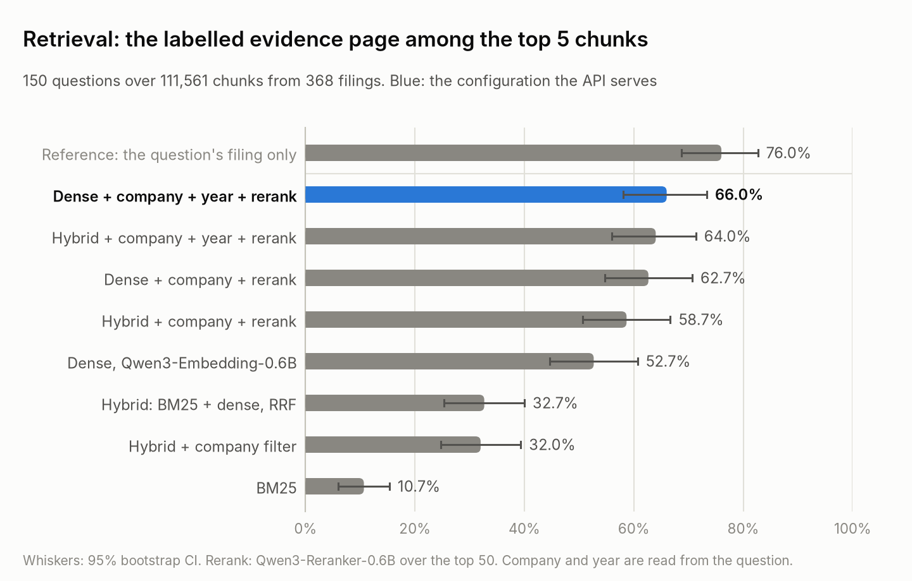
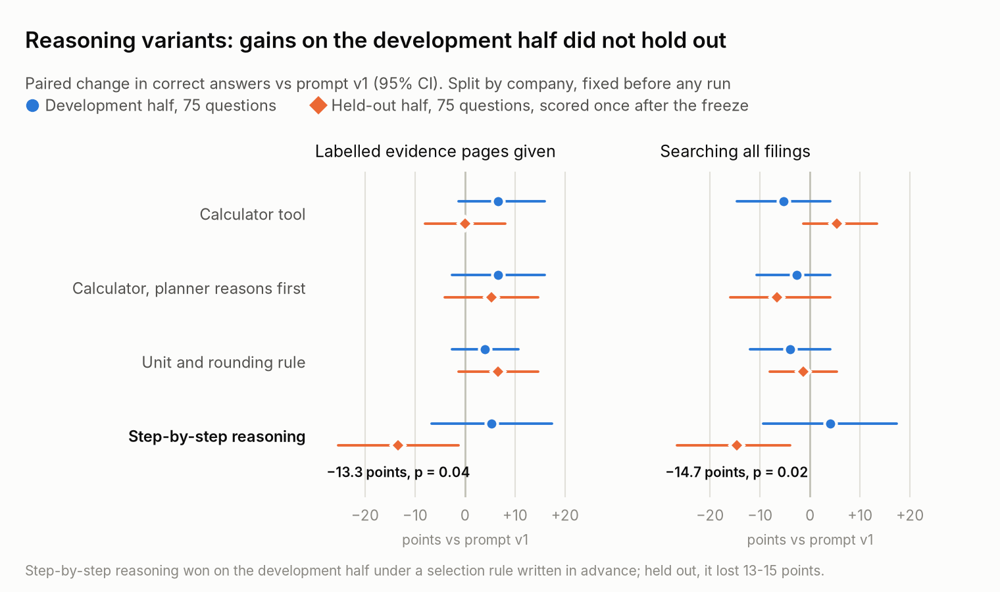
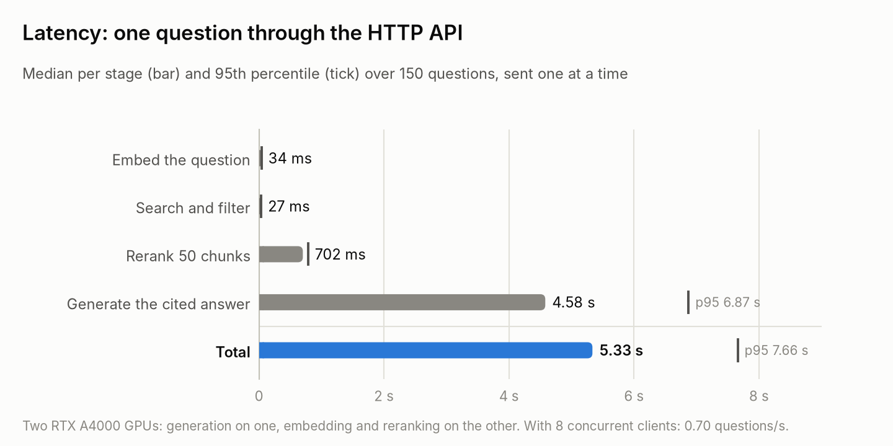

# finrag

Cited-answer question answering over company filings, measured on
[FinanceBench](https://github.com/patronus-ai/financebench): 150 analyst-written questions over 368 SEC
filings, each with a reference answer and the page that holds the evidence. Everything runs locally on two
16 GB GPUs: a 4B generator, a 0.6B embedding model and a 0.6B reranker.

<p align="center">
<picture>
  <source media="(prefers-color-scheme: dark)" srcset="docs/figures/accuracy-dark.png">
  
</picture>
</p>

## Results at a glance

| Measure | Result |
|---|---|
| Correct answers, searching all 368 filings | **60.7%** [52.7, 68.7]; GPT-4-Turbo in the FinanceBench paper: 19.3% |
| Correct answers, labelled evidence pages given | 64.0% [56.0, 71.3]; GPT-4-Turbo: 85.3% |
| Labelled evidence page among the top 5 / top 10 chunks | 66.0% / 80.7% |
| Unanswerable questions declined | 48 of 50, while answering 78% of the real questions at 70% accuracy |
| LLM judge against blind hand grades | agrees on 27 of 30 answers (Cohen's kappa 0.80) |
| Reasoning variants, checked on held-out questions | none beats the baseline; the development-half winner lost 14.7 points |
| HTTP API, one question at a time | 5.3 s median, 7.7 s at the 95th percentile; 0.70 questions/s with 8 clients |

Brackets are 95% bootstrap intervals over questions. Full report: [`results/RESULTS.md`](results/RESULTS.md).

## How it works

1. **Parse and chunk** every PDF page (PyMuPDF), into chunks of at most 512 tokens that never cross a page,
   each with a header naming the company, filing and page. A check confirms that the labelled evidence
   occurs on its labelled page.
2. **Retrieve** with BM25 and dense embeddings (Qwen3-Embedding-0.6B), optionally fused by reciprocal rank,
   restricted to the company and fiscal year named in the question (ticker / alias dictionary), and reranked
   by a cross-encoder (Qwen3-Reranker-0.6B).
3. **Answer** with a local model (Qwen3.5-4B through vLLM) in a fixed JSON format: reasoning, answer, cited
   excerpt numbers, and an `answerable` flag. Each answer is checked for valid citations and for numbers that
   appear in no cited excerpt.
4. **Grade** each answer against the reference with an LLM judge (Qwen3-14B-AWQ): correct / incorrect /
   refusal, as in the FinanceBench paper, whose human-graded runs are the baselines.

## Results

### Answers

Share of the 150 questions answered correctly.

| System | Searching all 368 filings | The question's filing only | Labelled evidence pages given |
|---|---|---|---|
| **FinRAG**, Qwen3.5-4B (LLM judge) | **60.7** [52.7, 68.7] | not run | 64.0 [56.0, 71.3] |
| GPT-4-Turbo (paper, human-graded) | 19.3 | 50.0 | 85.3 |
| GPT-4 (paper) | 16.7 | 42.0 | 84.0 |
| Llama 2 (paper) | 19.3 | 41.3 | not run |

Given the evidence pages, GPT-4-Turbo is far stronger than the 4B model (85.3 against 64.0), so FinRAG's lead
when it must search comes from retrieval, not from the generator. GPT-4-Turbo with one index over all filings
refused 67% of the questions: it did not find the evidence. FinRAG's answers in that setting: 60.7% correct,
33.3% incorrect, 6.0% refusals; 145 of 150 cite at least one excerpt and only excerpts that exist. A prompt that
discourages refusals made no significant difference (+1.3 and +2.0 points, p >= 0.68).

### Retrieval

<picture>
  <source media="(prefers-color-scheme: dark)" srcset="docs/figures/retrieval-dark.png">
  
</picture>

| Configuration | Page hit@5 | Page hit@10 | Filing hit@5 | MRR@20 |
|---|---|---|---|---|
| BM25 | 10.7 | 13.3 | 27.3 | 0.077 |
| Hybrid: BM25 + dense, reciprocal rank fusion | 32.7 | 46.0 | 70.7 | 0.239 |
| Hybrid + company filter | 32.0 | 44.0 | 77.3 | 0.243 |
| Dense (Qwen3-Embedding-0.6B) | 52.7 | 62.7 | 86.7 | 0.375 |
| Hybrid + company + rerank | 58.7 | 72.0 | 90.0 | 0.413 |
| Dense + company + rerank | 62.7 | 75.3 | 92.0 | 0.427 |
| Hybrid + company + year + rerank | 64.0 | 78.0 | 92.7 | 0.427 |
| **Dense + company + year + rerank** (served) | **66.0** [58.0, 73.3] | **80.7** | **93.3** | **0.438** |
| Reference: search only the question's own filing | 76.0 | 90.0 | 100.0 | 0.554 |

A hit means a retrieved chunk lies on a labelled evidence page (page) or in the labelled filing. Reranking is
the largest single gain (32.0 to 58.7). Fusion with BM25 *lowers* dense retrieval from 52.7 to 32.7: reciprocal
rank fusion weights both lists equally, and BM25 alone finds the page for only 10.7% of these questions. The year
filter adds 3 to 5 points. The served configuration is 10 points short of a search that already knows the
right filing.

### Abstention

50 unanswerable questions: FinanceBench questions with every year moved 10 years past the corpus, or the company
replaced by one outside it. A question counts as declined when the answer's `answerable` flag is false.

| Retrieval (prompt v1) | Real questions answered | Correct overall | Correct when answered | Unanswerable declined |
|---|---|---|---|---|
| **Dense + company + year + rerank** (served) | 78.0% | 60.7% | 70.1% | 48 / 50 |
| Hybrid + company + rerank | 77.3% | 58.0% | 69.8% | 50 / 50 |
| Hybrid + company + year + rerank | 79.3% | 59.3% | 66.4% | 50 / 50 |

The failures that get through: substituting the latest fiscal period, and attributing another company's figure.

### Reasoning experiment, with a held-out half

<picture>
  <source media="(prefers-color-scheme: dark)" srcset="docs/figures/experiment-dark.png">
  
</picture>

The 24 wrong answers to numerical and logical questions, given the evidence pages, were classified by hand:
arithmetic slips (6), judgement calls (6), missed extraction (5), unit and rounding format (3), another
definition in the reference (2), comparison logic (1), judge too strict (1). Four variants of prompt v1 target
these: a calculator tool (the model lists figures and expressions; Python evaluates them exactly), the same
with the planner justifying its line items first, a unit and rounding rule, and Qwen3.5's step-by-step
reasoning mode.

Protocol: the questions were split by company into a development half and a held-out half (75 each, no company
in both), committed before any variant ran. The selection rule was written before the results: adopt the variant
with the best development accuracy on retrieved context, if it beats v1 there by at least 2 points. All variants
were then frozen and the held-out half scored once.

Paired change in points against prompt v1 on the same questions (first row: prompt v1's own % correct):

| Variant | Evidence pages, development | Evidence pages, held out | Retrieved, development | Retrieved, held out | Output tokens (retrieved) |
|---|---|---|---|---|---|
| Prompt v1, % correct | 60.0 | 68.0 | 60.0 | 61.3 | 186 |
| Calculator tool | +6.7 | 0.0 | -5.3 | +5.3 | 374 |
| Calculator, planner reasons first | +6.7 | +5.3 | -2.7 | -6.7 | 434 |
| Unit and rounding rule | +4.0 | +6.7 | -4.0 | -1.3 | 178 |
| Step-by-step reasoning (development choice) | +5.3 | **-13.3** (p 0.04) | +4.0 | **-14.7** (p 0.02) | 6,561 |

Step-by-step reasoning was the development choice and failed on the held-out half: 16 to 17 of its 75 answers
there ran out of the 12,288-token budget, and the answers that finished were no better than v1's. It is not
adopted; prompt v1 stays the default (61.3% on the held-out half, 60.7% on all 150). Apart from that
regression, no variant's change is distinguishable from noise at 75 questions per half. Caveat: the variants
were designed from the error analysis of all 150 questions, done before the split.

### Judge check

30 randomly sampled answers were graded blind by hand. The judge agreed on correct against not correct for 27
(Cohen's kappa 0.80) and was slightly stricter (50.0% correct, against 53.3% by hand). Judge numbers are still
not directly comparable with the paper's human grades.

### Latency

<picture>
  <source media="(prefers-color-scheme: dark)" srcset="docs/figures/latency-dark.png">
  
</picture>

| Stage | Median | 95th percentile |
|---|---|---|
| Embed the question | 34 ms | 39 ms |
| Search and filter, in memory | 27 ms | 35 ms |
| Rerank 50 chunks | 702 ms | 784 ms |
| Generate the cited answer | 4.58 s | 6.87 s |
| **Total** | **5.33 s** | **7.66 s** |

150 questions sent one at a time. With 8 concurrent clients: 0.70 questions/s, wall time 10.3 s median and
17.9 s at the 95th percentile.

### Engineering findings

- Constrained JSON decoding looped (whitespace, then the citations array) until the schema was bounded.
- vLLM 0.31 ignores the per-request whitespace switch; only the engine-level setting works.
- Compact JSON flipped the model's `answerable` flag on 87 of 150 answers, until llguidance with natural
  `", "` / `": "` separators restored it.

Prompt v2 and the year-filtered configurations were chosen after seeing results on the same 150 questions;
only the reasoning experiment has a held-out half.

## Service

`serve.sh up` starts three vLLM model servers (generation on one GPU; embedding and reranking on the other,
OpenAI-compatible, localhost only) and a FastAPI app that does retrieval in memory and calls them:

- `POST /ask` `{"question": "...", "company": null}` returns the answer, the cited filings and pages with excerpts,
  an `abstained` flag, citation and number checks, and per-stage timings.
- `POST /ask/stream`: the same, as Server-Sent Events (retrieval, then answer tokens, then the result).
- `GET /health`.

`bench.py` measures latency (sequential and concurrent); see the report's latency section.

## Running it

On a Linux machine with an NVIDIA GPU (16 GB is enough):

```bash
./setup.sh                 # uv, Python 3.11, vLLM, model weights, FinanceBench
./batch.sh                 # prep -> index -> search -> gen -> grade -> abstention -> experiment -> report
./serve.sh up              # model servers + HTTP API on 127.0.0.1:8010 (/docs for the OpenAPI page)
python bench.py            # API latency, sequential and concurrent
python plots.py            # README figures, from results/
python test.py             # unit tests (no GPU needed)
```

Single stages: `python run.py {prep,index,search,gen,grade,abstain,freeze,report}`; settings are in `configs/`.

FinanceBench is fetched, not redistributed; cite Islam et al., *FinanceBench* (arXiv:2311.11944).
